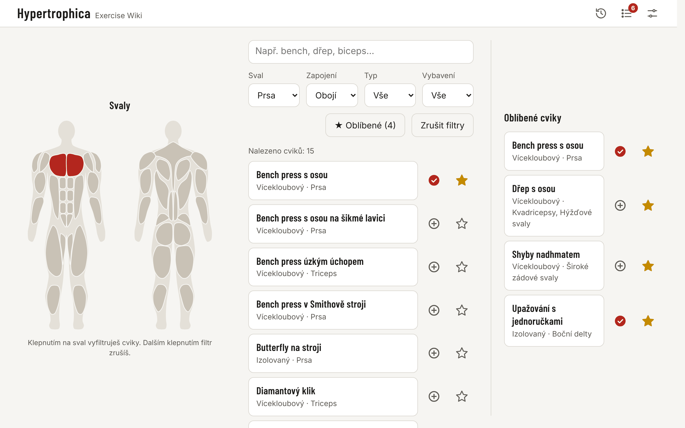
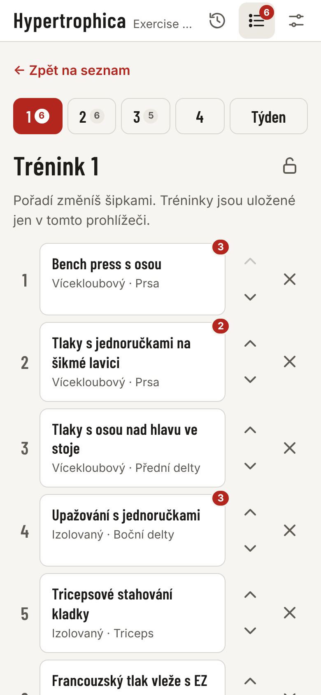
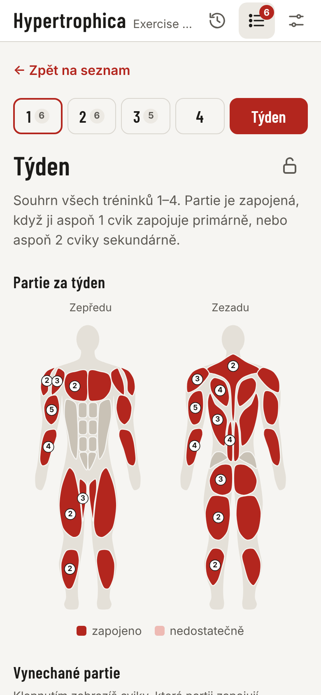
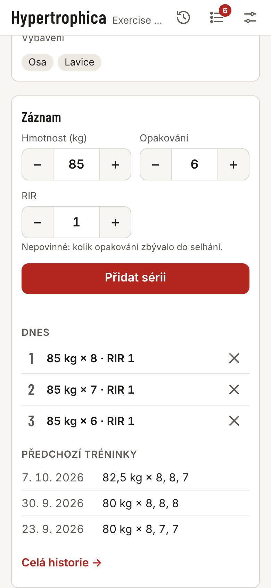
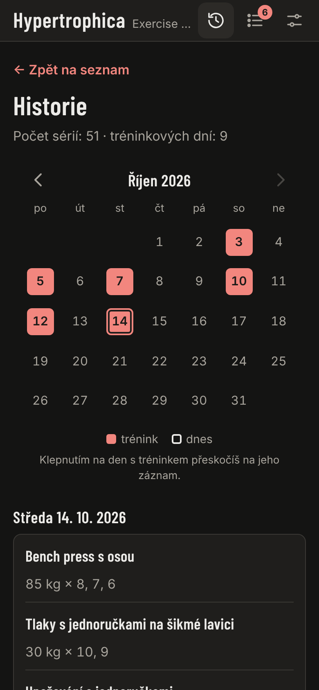
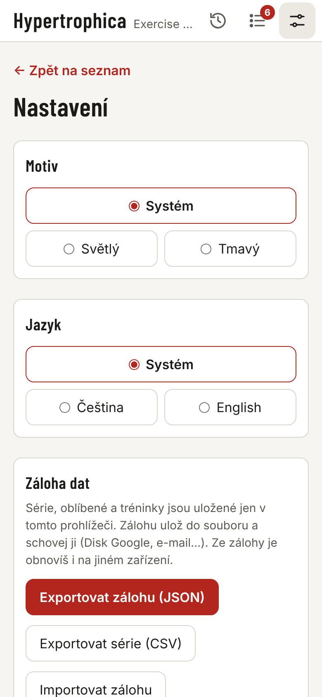

# Hypertrophica

**English** · [Čeština](README.cs.md)

**Hypertrophica – Exercise Wiki.** A personal exercise handbook for hypertrophy training (building muscle): find exercises by muscle, plan your weekly workouts, log your sets and track your progress. It runs in the browser on desktop and mobile, can be installed as an app and works offline.

👉 **Open the app: <https://pajainzenyr.github.io/hypertrophica/>**



> The name *Hypertrophica* is Latin for "things concerning hypertrophy" – modelled on old textbook titles such as *Physica* or *Botanica*.

*The screenshots show the Czech interface; the app is also available in English (see [Settings](#settings-backup-and-restore)).*

---

## The idea

Training for size keeps raising the same questions: *What hits the rear delts? What can I do with just dumbbells? Am I skipping a muscle group this week? How much did I bench last time?* The answers tend to be scattered across videos, phone notes and memory.

Hypertrophica puts them in one place:

- **Exercise wiki** – every exercise has instructions, primary and secondary muscles, type and required equipment.
- **Muscle-first view** – a clickable body map: tap a muscle to see the exercises that work it.
- **Weekly plan and check** – up to 4 workouts and a summary of which muscle groups the week covers and which are left out.
- **Training log** – log sets right in the exercise detail, with a history and calendar.

Principles behind the app:

- **Simplicity.** No accounts, sign-ups or ads. Open it and use it.
- **Privacy.** Your data (favourites, workouts, sets) stays on your device only. Nothing is sent to a server; moving data between devices works through a backup file.
- **Offline.** After the first load it works even in a gym with no signal.
- **Mobile first.** Large thumb-friendly buttons, light and dark mode.

---

## Features

| Feature | In short |
|---|---|
| 🔎 **Search** | Find exercises by name, ignoring diacritics and letter case ("drep" finds "Dřep"). Searches both Czech and English names. |
| 🎛️ **Filters** | Muscle (primary / secondary involvement), type (compound / isolation), equipment, favourites. Filters combine. |
| 🧍 **Muscle map** | Front and back view of the body. Tapping a muscle filters by it; the active muscle is highlighted. |
| 📖 **Exercise detail** | Execution, muscles involved (also shown on the map), type, equipment, notes and tips. |
| ⭐ **Favourites** | Star an exercise, quick list of favourites. |
| 📋 **Workouts 1–4** | Ordered exercise lists, map of muscles involved, sharing via link, lock against accidental edits. |
| 📅 **Week** | Summary of all workouts: which muscle groups are trained, insufficiently trained or missed. |
| 🏋️ **Set logging** | Weight, reps and RIR right in the exercise detail, prefilled from last time, summary of recent workouts. |
| 🕘 **History** | All sets by day and a workout calendar. |
| 💾 **Backup** | Export / import all data as a JSON file, export sets to CSV for Excel. |
| 🌗 **Theme** | Light, dark or follow the system. |
| 🌐 **Language** | Czech or English, defaulting to the browser language. |
| 📱 **Install (PWA)** | Add to the phone home screen, works offline. |

The database contains dozens of exercises across 19 muscle groups and keeps growing.

<p>
  
  
  
  
  
</p>

*From left: workout, week summary, set logging in the exercise detail, history in dark mode, settings with theme and language choice.*

---

## Quick start

1. **Open** <https://pajainzenyr.github.io/hypertrophica/> in a browser.
2. **Install it on your phone** (recommended – it then behaves like a regular app and works offline):
   - **Android (Chrome):** menu ⋮ → *Add to Home screen* / *Install app*.
   - **iPhone (Safari):** Share button → *Add to Home Screen*.
3. **Find an exercise** – type its name into the search box, or tap a muscle on the map.
4. **Build a workout** – the ⊕ button next to an exercise adds it to the active workout. Open your workouts with the list icon in the header.
5. **Log sets while training** – in the exercise detail, *Log* section: weight, reps, *Add set*.
6. **Back up now and then** – *Settings* → *Export backup (JSON)*. Your data lives only on this device.

---

## Feature guide

### Exercise list, filters and muscle map

- **Search** by name, ignoring diacritics and letter case. Both Czech and English names are searched regardless of the selected language.
- **Filters:** *Muscle* (with *Involvement*: primary / secondary / both), *Type*, *Equipment* and *Favourites*. All apply at once. *Clear filters* resets everything.
- **Muscle map:** switch between *Front* / *Back*; tapping a muscle sets the filter, tapping again clears it. A muscle filter set in the list is highlighted on the map as well.
- The *Equipment* filter only offers equipment used by at least one exercise.

### Exercise detail

Execution, primary and secondary muscles (also colour-coded on the map), type, equipment and notes (variations, tips, safety). The star adds the exercise to favourites, ⊕ to the active workout. Below is the *Log* section for recording sets.

**Leaving the detail:** the *← Back to …* link at the top, the **Esc** key, or on desktop (width 900 px and up) a click into the empty space left or right of the content. When the cursor is in a *Log* form field, the first Esc only leaves the field, the second goes back. On mobile only via the link (the margins are narrow and the detail could close by accident).

### Favourites

The star next to an exercise in the list or in the detail. Favourite exercises have their own panel and can be used as a filter.

### Workouts 1–4 and Week

Simple workout plans: up to 4 workouts (*Workout 1–4*), each an ordered list of exercises, without sets, reps or weights. The *Week* tab shows which muscle groups the workouts cover together and which are left out.

- **Switcher:** in the workout view, a row of buttons *1 2 3 4 Week*. The small number on a button = number of exercises in that workout. Tapping 1–4 makes that workout **active**.
- **Add / remove:** the ⊕ button next to an exercise in the list or detail adds it to the **active** workout (✓ = already in it). New exercises go to the end. The same exercise can be in several workouts.
- **Opening:** the list icon in the header (badge = number of exercises in the active workout), URL `#/trenink`; week summary at `#/tyden`.
- **Done today:** an exercise with sets logged today shows a circle with today's set count in the top-right corner of its card. The circles disappear the next day.
- **Order:** arrows ↑ ↓ next to an exercise, × removes it, *Clear workout* empties the active workout.
- **Lock:** the lock icon next to the heading, applies to all workouts at once. Locked workouts hide the arrows, ×, *Clear workout* and *New week*, and exercises cannot be removed even via ✓ in the list or detail – protection against accidental taps during training.
- **Muscles in workout:** below the exercise list is a body map. Solid colour = muscles that are primary for some exercise, lighter colour = muscles involved only as secondary. The number on a muscle group = number of exercises in the workout that work it.
- **Week:** adds up exercises from all 4 workouts (an exercise in two workouts counts twice). A muscle group is
  - **trained** when at least 1 exercise works it as primary **or** at least 2 exercises as secondary (solid colour),
  - **insufficiently trained** when only 1 exercise works it, as secondary (lighter colour),
  - **missed** when no exercise works it (no colour).

  Below the map, missed and insufficiently trained muscle groups are listed as buttons – tapping one shows the exercises that work it as primary. *New week* clears all 4 workouts.
- **Sharing:** *Copy link* (on mobile also *Share*) creates the URL `…/hypertrophica/#/trenink?cviky=id1,id2,…` with the active workout. Whoever opens it sees a preview of the workout and can adopt it with *Save as my workout N* (replaces their active workout). The link contains only exercise IDs; nothing is stored on a server.

### Set logging and history

- **Logging:** in the exercise detail, *Log* section: weight in kg (decimal comma or point, `0` = bodyweight), reps and optionally **RIR** (*reps in reserve* – how many reps were left before failure, 0–10). The − and + buttons change values without typing (weight in 2.5 kg steps). *Add set* saves the set; the form keeps its values, so the next identical set is a single tap.
- **Prefill:** when the detail opens, the form is filled with the values of the exercise's last logged set.
- **In the detail** there is a list of today's sets (× deletes a set) and a summary of the exercise's last 5 workouts, e.g. `80 kg × 8, 8, 7 · 85 kg × 6` (consecutive sets with the same weight are merged).
- **History:** the clock icon in the header, URL `#/historie`. All sets by day (newest first), grouped by exercise within a day. 20 days are shown; *Show older* loads more. The calendar (left on desktop, above the list on mobile) highlights training days; tapping a day jumps to its entry.

### Settings, backup and restore

The sliders icon in the header, URL `#/nastaveni`. The end of *History* also links here (*Backup and restore → Settings*).

- **Theme:** *System* (follows the device setting) / *Light* / *Dark*.
- **Language:** *System* / *Čeština* / *English*. *System* = based on the browser language (Czech and Slovak → Czech, otherwise English). The page reloads automatically after a change.
- **Export backup (JSON):** downloads the file `hypertrophica-zaloha-YYYY-MM-DD.json` with **all** data – sets, favourites and workouts 1–4. Keep it somewhere safe (Google Drive, an e-mail to yourself…).
- **Import backup:** pick a backup file. The app checks it and shows what it contains. Then choose:
  - **Merge with data on this device** – adds sets missing on the device (the same set is never duplicated), combines favourites and fills only empty workouts.
  - **Replace all** – after confirmation deletes the data on the device and restores it from the backup.
  - Invalid sets and sets of exercises no longer in the data are skipped (the preview shows how many).
- **Export sets (CSV):** a table for Excel / Google Sheets. In English the file is `hypertrophica-sets-YYYY-MM-DD.csv` with columns `date;exercise;exercise_id;set;reps;weight_kg;rir` and English exercise names; in Czech `hypertrophica-serie-…csv` with Czech column and exercise names. Both use a semicolon separator and decimal comma. Meant for viewing and charts – **it cannot be imported back**; use the JSON backup for that.
- **Moving to another device:** export JSON on the old device → transfer the file → import on the new one.

### Where your data lives

Everything is stored **only in the browser of the given device**; nothing goes to a server:

| Data | Storage |
|---|---|
| Favourites | `localStorage`, key `hw.favorites` |
| Workouts 1–4 | `localStorage`, key `hw.week` (`{ "active": 0, "slots": [[…], […], […], […]] }`) |
| Workout lock | `localStorage`, key `hw.planLocked` |
| Theme | `localStorage`, key `hw.theme` |
| Language | `localStorage`, key `hw.lang` (no key = follow the browser) |
| Sets | IndexedDB, database `hypertrophica` (module `js/log.js`) |

- Clearing browser data deletes your data – so **back up regularly**.
- On the first logged set the app asks the browser for persistent storage (`navigator.storage.persist()`) so that data is not evicted when space runs low.
- **iPhone:** use the app added to the home screen – otherwise Safari deletes the data of websites not opened for 7 days.
- A workout saved by an older app version (key `hw.plan`) is moved to *Workout 1* automatically on first start.

---

## For maintainers

This part is for whoever edits the app – adds exercises or changes the code.

### How the app works technically

- Static web app: **vanilla HTML, CSS and JavaScript** (ES modules), no framework, no build step, no external libraries, fonts or trackers.
- Hosted on **GitHub Pages** directly from the `main` branch.
- Content lives in JSON files, which the app loads on start.

```
index.html          # page
style.css           # styles
app.js              # entry point, app state, rendering
js/                 # modules: filters, favourites, body map, workouts, set log, backup, theme, texts
data/
  exercises.json    # exercise database (the main edited file)
  muscles.json      # muscle groups
i18n/               # UI texts: cs.json (Czech), en.json (English)
assets/             # muscle map (SVG), icons, font
manifest.json       # PWA description (name, icons)
sw.js               # service worker – offline mode
tools/              # data check (validate.html), scripts generating the SVG map and icons
docs/screenshots/   # screenshots for README.md and README.cs.md (not used by the app)
```

- Exercise data: [`data/exercises.json`](data/exercises.json)
- Muscle groups: [`data/muscles.json`](data/muscles.json)
- UI texts: [`i18n/cs.json`](i18n/cs.json), [`i18n/en.json`](i18n/en.json) – both files must have the same keys; add every new text to both.

### Adding an exercise

Exercises are in `data/exercises.json`. It is a list (array) of objects separated by commas; put a new exercise next to the others for the same muscle group.

```json
{
  "id": "incline-curl-dumbbell",
  "name": { "cs": "Bicepsový zdvih na šikmé lavici", "en": "Incline Dumbbell Curl" },
  "type": "isolation",
  "primary": ["biceps"],
  "secondary": [],
  "equipment": ["dumbbell", "bench"],
  "description": { "cs": "Popis provedení…", "en": "How to perform…" },
  "notes": { "cs": "Tipy, varianty, bezpečnost…", "en": "Tips, variations, safety…" }
}
```

| Field | What goes in it |
|---|---|
| `id` | Unique identifier in kebab-case (lower case, words separated by hyphens). **Never change it once added** – saved favourites, workouts, sets and shared links refer to it. |
| `name` | Name in Czech (`cs`) and English (`en`). |
| `type` | Only `"compound"` or `"isolation"`. |
| `primary` | Main muscles worked – IDs from the table below. |
| `secondary` | Assisting muscles – IDs from the table below, may be empty `[]`. Do not put the same muscle in both `primary` and `secondary`. |
| `equipment` | Required equipment – IDs from the table below. List **everything needed at the same time** (e.g. `["dumbbell", "bench"]`). |
| `description` | Execution in Czech (`cs`) and English (`en`). |
| `notes` | Notes (variations, tips) in Czech and English. May stay `""`. |

If an English text is missing, the English UI shows the Czech one – so ideally fill in both languages for a new exercise. Exercises no longer in the data are silently skipped in workouts and shared links.

#### Muscle groups (`primary`, `secondary`)

| ID | Name | | ID | Name |
|---|---|---|---|---|
| `chest` | Chest | | `rear_delts` | Rear delts |
| `front_delts` | Front delts | | `traps` | Traps |
| `side_delts` | Side delts | | `lats` | Lats |
| `biceps` | Biceps | | `upper_back` | Upper back |
| `forearms` | Forearms | | `lower_back` | Lower back |
| `abs` | Abs | | `triceps` | Triceps |
| `obliques` | Obliques | | `glutes` | Glutes |
| `quads` | Quads | | `hamstrings` | Hamstrings |
| `adductors` | Adductors | | `abductors` | Abductors |
| `calves` | Calves | | | |

A new muscle group requires changing `data/muscles.json` and the SVG map (`tools/generate-body-map.py`) – that is no longer a routine data edit.

#### Equipment (`equipment`)

| ID | Name in filter | When to use |
|---|---|---|
| `barbell` | Barbell | Olympic or straight bar |
| `ez_bar` | EZ bar | Cambered bar |
| `dumbbell` | Dumbbells | |
| `cable` | Cable | |
| `machine` | Machine | Weight machine with its own movement path |
| `smith_machine` | Smith machine | Bar guided on fixed rails; list the bench separately (`bench`) |
| `bench` | Bench | Flat, incline and preacher bench |
| `squat_rack` | Rack | |
| `pullup_bar` | Pull-up bar | |
| `back_extension_bench` | Back extension bench | |
| `dip_bars` | Dip bars | |
| `rings` | Rings | Gymnastic rings |
| `bodyweight` | Bodyweight | The load is mainly your own body. Always include it, even when the exercise needs other equipment too (e.g. `["bodyweight", "pullup_bar"]`), so the "Bodyweight" filter finds it. |
| `unspecified` | Unspecified | The exercise needs an aid that is not fixed (e.g. inverted row – any bar at waist height; Nordic curl – anything to anchor the heels). Describe the specific options in `notes`. |

**To add new equipment**, add its ID and name to `i18n/cs.json` (Czech) and `i18n/en.json` (English) in the `"equipment"` section and list it in the table above (in both READMEs). Without an `i18n` entry the filter would show the technical ID instead of a name.

#### Check before saving

The data is checked by the page **[`tools/validate.html`](tools/validate.html)** – open it in the browser at <https://pajainzenyr.github.io/hypertrophica/tools/validate.html> (or locally at `http://localhost:8000/tools/validate.html`). It lists errors in red and warnings in yellow; when everything is fine it shows a green *✓ Vše v pořádku* ("all OK"). It checks:

- exercises: unique kebab-case `id`, `type`, existing muscles and equipment, no muscle in both `primary` and `secondary`, `en` filled in wherever `cs` is;
- muscle groups: unique `id`, names, Latin names, `front`/`back` views;
- UI texts: `i18n/cs.json` and `i18n/en.json` have the same keys and the same `{…}` placeholders;
- muscle map: every muscle from `muscles.json` is in the SVG and the SVG has no duplicate `id`.

The validator always reads the current files from the server (bypassing the service worker cache), so after a merge just wait for the deployment and open the page. Also make sure that:

- The JSON is valid (otherwise the validator reports "invalid JSON"): strings in double quotes `"`, commas between objects, **no** comma after the last object.
- `CACHE_VERSION` in `sw.js` has been increased (see *Offline mode*).

### Deployment

GitHub Pages serves the files directly from the `main` branch (root directory), with no build step. Every change goes through its own branch and Pull Request; after the merge into `main` the site is usually updated within 1–2 minutes.

### Offline mode (PWA)

`manifest.json` describes the name and icons; the service worker `sw.js` stores all files in the browser cache, so after the first load the app works without internet.

- **Increase `CACHE_VERSION` in `sw.js` with every content or code change** (e.g. `1` → `2`). The service worker serves files from the cache; the browser detects a new version only through a change in `sw.js`. After deployment the new version is downloaded when the app is opened and shown after the next page reload (close and reopen an installed app).
- If you add a new file (JS module, image…), add it to the `FILES` list in `sw.js` as well, otherwise it will not be available offline.
- The icons in `assets/icons/` are generated by `python3 tools/generate-icons.py` (requires Pillow) – do not edit them by hand. The map `assets/body-map.svg` is generated by `python3 tools/generate-body-map.py`.

### Testing

- **After the merge**, test the change at <https://pajainzenyr.github.io/hypertrophica/> on desktop and mobile using the checklist in the PR description.
- **Before the PR**, the change is verified in the cloud environment: local server `python3 -m http.server 8000` in the project root and a check in a headless browser (loads without errors, filters, workouts, set logging, backup and import, mobile width ~375 px).
- If a change does not show up on the site, it is almost always the service worker cache: check that `CACHE_VERSION` was increased and reload the page twice (close and reopen an installed app).
- Opening from disk (`file://`) does not work, because the browser cannot load data via `fetch` that way – always use a local server and open `http://localhost:8000`.

## License

The project's code and data are under the [MIT](LICENSE) license: anyone may use, modify and distribute them as long as the copyright notice is kept. The Barlow Condensed font in `assets/fonts/` has its own license, [SIL Open Font License 1.1](assets/fonts/OFL.txt).
